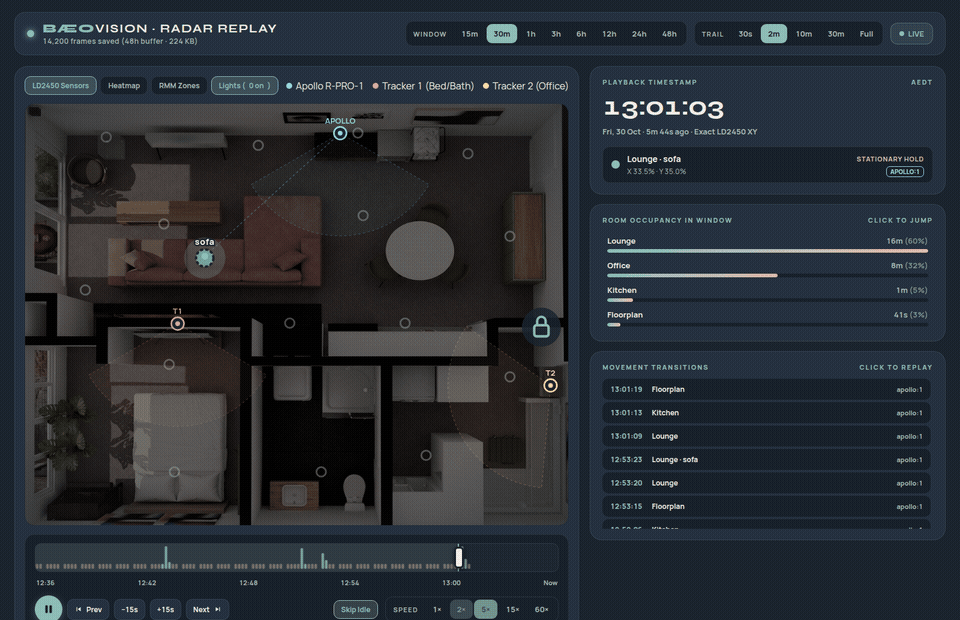
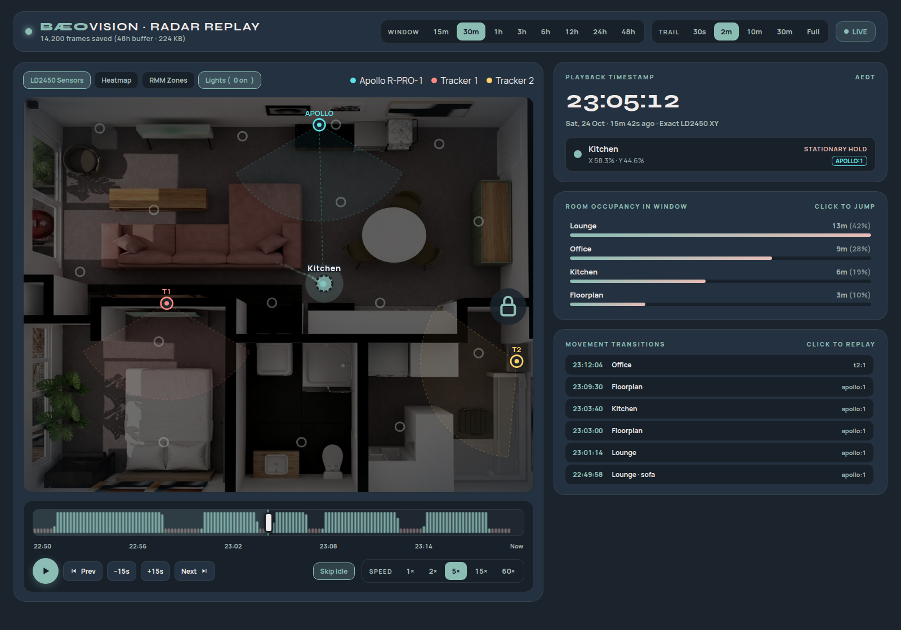
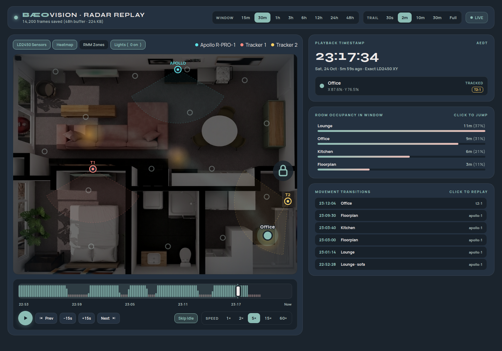
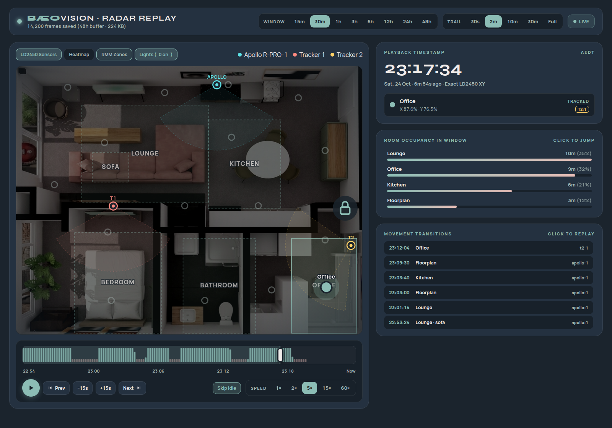
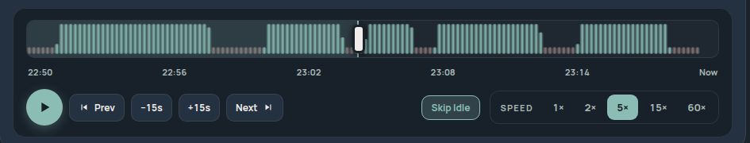

# Home Assistant Radar Replay (`ha-rmm-replay`)

[](https://github.com/hacs/default)
[](https://www.home-assistant.io/)
[](LICENSE)
[](#)

> **Continuous 24h–48h spatial movement recorder, timeline scrubber, and high-performance playback dashboard for Home Assistant and [Radar Map Manager](https://github.com/Limych/radar_map_manager).**



---

## Overview

### The Problem
Hilink **LD2450 mmWave radar sensors** (such as the Apollo Automation MSR-1, Apollo R-PRO-1, and ESPHome-based trackers) stream 2D positional targets at high frequency (~2 Hz). 

If you try to log raw `target_x` and `target_y` sensor states into Home Assistant's standard SQLite `recorder`, it quickly writes **over 500,000 state changes per day**. This causes:
- Massive database growth (multi-gigabyte `.db` bloat)
- Sluggish Home Assistant startup and backup creation
- Unusable native history graphs
- Heavy storage wear on SD cards and eMMC drives

Consequently, most users exclude raw radar coordinates from the recorder and rely on live floorplans or cards (e.g. Bæovision TV ambient displays), which only display live points or transient 20–30 second in-browser tails. You could never see *where someone walked an hour ago*, *how long they lingered in a room*, or *scrub backward to see when someone left*.

### The Solution
**`ha-rmm-replay`** bridges this gap:
1. **Delta-Deduplicating Spatial Recorder**: A dedicated background service listens directly to the 2 Hz `rmm/stream` WebSocket or event bus outside SQLite. It logs a compact delta frame only when spatial coordinates move by $\ge 0.16\%$ of the map (~1.3 cm). During stationary dwell periods, it records a lightweight 15s heartbeat, and a 60s heartbeat when empty.
2. **Sub-3 MB Storage Footprint**: An entire **48-hour buffer** of fluid movement history across multiple radar targets occupies only **~1.5 MB to 3 MB** in a rolling JSONL buffer (`rmm_movement_history.jsonl`), completely bypassing SQLite.
3. **Interactive Lovelace Replay Card**: A hardware-accelerated SVG and Canvas card (`custom:rmm-replay-card`) featuring an interactive timeline scrubber, activity sparklines, variable playback speed (`1×`–`60×`), spatial occupancy density heatmaps, raw sensor radar cones/rays, room dwell statistics, and click-to-replay transition event logs.

---

## Key Features

| Feature | Description |
| :--- | :--- |
| ⏱️ **Multi-Hour Windows** | Instant one-click toggles for **`15m`**, **`30m`**, **`1h`**, **`3h`**, **`6h`**, **`12h`**, **`24h`**, and **`48h`** history windows. |
| 📊 **Activity Sparkline Scrubber** | Interactive timeline scrubber bar displaying a movement density histogram. Distinguishes active motion (**teal**) from stationary dwell (**warm rose**) so you can spot activity bursts instantly. |
| ⏯️ **Transport Controls** | Play/Pause, step backward/forward 15s, jump to previous/next movement transition, playback speeds (`1×`, `2×`, `5×`, `15×`, `60×`), and **Skip Idle** (automatically fast-forwards over dead air $>12\text{s}$). |
| 🔴 **Live Mode** | Real-time streaming mode connecting directly to Home Assistant's `rmm/stream` WebSocket with zero latency. |
| 👣 **Customizable Breadcrumbs** | Fading movement trails with selectable tail durations: **`30s`**, **`2m`**, **`10m`**, **`30m`**, or **`Full`** window path. |
| 🔥 **Spatial Density Heatmap** | Computes and overlays a 2D Gaussian heat density map across the chosen time window to visualize room usage hot spots. |
| 📡 **Multi-Sensor Radar Fusion** | Renders physical radar mounting origins, $120^\circ$ FOV detection wedges, raw sensor coordinate dots, and dynamic tracking rays for each radar node (e.g. Apollo R-PRO-1, ESPHome LD2450s). |
| 📐 **RMM Zone Polygons** | Visualizes Radar Map Manager include/stationary polygons with real-time and historical occupancy highlights. |
| 📈 **Room Dwell Breakdown** | Analytics panel showing duration and percentage of time spent in each room/zone during the window, with click-to-jump. |
| 📋 **Movement Transition Log** | Chronological log of room entries and exits with one-click seek to replay any transition. |
| 💡 **Interactive Floorplan Controls** | Synchronized light pools and smart door lock indicators with click-to-toggle support. |

---

## Visual Tour

### Full Dashboard Overview
Complete view showing active target trail from Lounge to Kitchen, Apollo $120^\circ$ FOV detection wedge, activity sparkline timeline, and room dwell breakdown:



---

### Spatial Occupancy Heatmap Mode
One-click heatmap overlay visualizing dwell density over the selected time window:



---

### Radar FOV Cones & RMM Zones
Displays physical sensor mounting locations, coverage wedges, raw detections, and room zone polygons:



---

### Activity Sparkline Scrubber
Close-up of the scrubber bar showing the movement density histogram and transport controls:



---

## Architecture & How It Works

```
 ┌─────────────────────────────────────────────────────────┐
 │                   Home Assistant Core                   │
 │                                                         │
 │  ┌──────────────────────┐      ┌─────────────────────┐  │
 │  │ LD2450 Radar Nodes   │      │  Radar Map Manager  │  │
 │  │ (Apollo / ESPHome)   │ ───► │  (Multi-Sensor)     │  │
 │  └──────────────────────┘      └──────────┬──────────┘  │
 └───────────────────────────────────────────┼─────────────┘
                                             │ 2 Hz rmm/stream
                                             ▼
 ┌─────────────────────────────────────────────────────────┐
 │           Delta-Deduplicating Recorder Engine           │
 │           (Native In-Core or Standalone Daemon)         │
 │                                                         │
 │   • Filter jitter & sub-centimeter noise (< 0.16%)      │
 │   • Log movement frames at max ~2 Hz                    │
 │   • Heartbeat: 15s when occupied, 60s when empty        │
 │   • Rolling 48-Hour Pruning                             │
 └─────────────────────────────┬───────────────────────────┘
                               │
                ┌──────────────┴──────────────┐
                ▼                             ▼
   /config/.storage/              /config/www/rmm-replay/
   rmm_movement_history.jsonl     history_24h.json
   (Rolling 48h append-log)       (Atomic cached export)
                │                             │
                └──────────────┬──────────────┘
                               │ HTTP / WebSocket (rmm/history)
                               ▼
 ┌─────────────────────────────────────────────────────────┐
 │                Home Assistant Frontend                  │
 │                                                         │
 │  ┌──────────────────────────────────────────────────┐   │
 │  │  <rmm-replay-card> (Lovelace Custom Card)        │   │
 │  │  • Canvas Breadcrumb Trails & Heatmap Engine     │   │
 │  │  • Interactive Timeline Scrubber & Sparklines    │   │
 │  │  • Zone Analytics & Click-to-Seek Log            │   │
 │  └──────────────────────────────────────────────────┘   │
 └─────────────────────────────────────────────────────────┘
```

### Storage Efficiency
- **Coordinate Delta Compression**: New frames are written only when a target moves $\ge 0.16\%$ of the map dimensions (~1.3 cm in a typical room) or when raw radar targets shift by $\ge 0.35\%$.
- **Stationary Hold Throttling**: When someone sits on a couch or works at a desk, the recorder writes a single keyframe every 15 seconds.
- **Empty Room Throttling**: When no targets are present, a heartbeat is logged every 60 seconds.
- **Result**: 48 hours of continuous, dense multi-target tracking consumes **only ~1.5 MB to 3 MB** on disk.

---

## Installation

### Step 1: Install the Lovelace Card
1. Copy `dist/rmm-replay-card.js` to your Home Assistant `www` folder:
   ```bash
   mkdir -p /config/www/rmm-replay
   cp dist/rmm-replay-card.js /config/www/rmm-replay/
   ```
2. (Optional) Copy custom fonts and floorplan geometry:
   ```bash
   cp -r src/standalone/fonts /config/www/rmm-replay/
   cp examples/floorplan.sample.json /config/www/rmm-replay/floorplan.json
   ```
3. Register the Lovelace resource in Home Assistant (**Settings** $\rightarrow$ **Dashboards** $\rightarrow$ **Three dots** $\rightarrow$ **Resources**):
   - **URL**: `/local/rmm-replay/rmm-replay-card.js?v=1`
   - **Resource Type**: `JavaScript Module`

---

### Step 2: Set Up the Movement Recorder

You can choose either of two deployment modes:

#### Option A: Native In-Core Integration (Recommended)
Integrates directly with the `radar_map_manager` custom component:
1. Copy `backend/custom_component/history_recorder.py` into your RMM component folder:
   ```bash
   cp backend/custom_component/history_recorder.py /config/custom_components/radar_map_manager/
   ```
2. In `/config/custom_components/radar_map_manager/__init__.py`, import and initialize the recorder in `async_setup_entry`:
   ```python
   # In async_setup_entry:
   from .history_recorder import async_setup_recorder
   hass.data["rmm_history_recorder"] = await async_setup_recorder(hass)
   ```
3. Restart Home Assistant. The recorder will run natively inside HA Core and register the `rmm/history` WebSocket command.

#### Option B: Standalone Daemon (Zero HA Code Modifications)
Runs as an independent Python process connecting to Home Assistant over WebSocket:
1. Ensure `python3` and `aiohttp` are installed:
   ```bash
   pip install aiohttp
   ```
2. Copy `backend/daemon/recorder_daemon.py` to `/config/www/rmm-replay/recorder_daemon.py`.
3. Create a systemd service or use the provided s6 script:
   ```bash
   sudo cp backend/daemon/rmm-recorder.service /etc/systemd/system/
   sudo systemctl daemon-reload
   sudo systemctl enable --now rmm-recorder.service
   ```

---

### Step 3: Add the Card to your Dashboard

#### Standard Card
Add a manual card in your Lovelace view:
```yaml
type: custom:rmm-replay-card
default_window_hours: 0.5
default_trail_secs: 120
image_url: /local/images/floorplan_cropped.png
floorplan_url: /local/rmm-replay/floorplan.json
history_url: /local/rmm-replay/history_24h.json
```

#### Fullscreen Panel View
To create a dedicated control room dashboard (like Bæovision), create a new dashboard with `panel: true`:
```yaml
title: Radar Replay
views:
  - title: Radar Replay
    path: default_view
    icon: mdi:motion-play
    panel: true
    cards:
      - type: custom:rmm-replay-card
        default_window_hours: 0.5
        default_trail_secs: 120
```

---

## Standalone / Kiosk Display

The project includes `src/standalone/index.html`, allowing you to run the replay viewer in a browser tab, kiosk, or wall tablet without the Home Assistant sidebar:

- Open `http://<YOUR_HA_IP>:8123/local/rmm-replay/index.html`
- Supports URL query parameters:
  - `?win=1`: Sets 1-hour window
  - `?trail=600`: Sets 10-minute breadcrumb trail
  - `?heatmap=1`: Opens directly with heatmap enabled
  - `?zones=1`: Opens with RMM zones visible
  - `?noraw=1`: Hides raw sensor wedges

---

## Configuration Reference

| Option | Type | Default | Description |
| :--- | :--- | :--- | :--- |
| `type` | `string` | **Required** | Must be `custom:rmm-replay-card`. |
| `default_window_hours` | `number` | `0.5` | Default timeline window on load (`0.25`, `0.5`, `1`, `3`, `6`, `12`, `24`, `48`). |
| `default_trail_secs` | `number` | `120` | Default breadcrumb trail length in seconds (`30`, `120`, `600`, `1800`, or `172800` for Full). |
| `image_url` | `string` | `"/local/images/floorplan_cropped.png"` | Path to your background 2D or 3D floorplan image. |
| `floorplan_url` | `string` | `"/local/rmm-replay/floorplan.json"` | Path to floorplan geometry and lights metadata. |
| `history_url` | `string` | `"/local/rmm-replay/history_24h.json"` | Path to HTTP-cached history JSON file. |

---

## Project Structure

```
ha-rmm-replay/
├── README.md                          # Comprehensive documentation & media
├── LICENSE                            # MIT License
├── dist/                              # Lovelace custom card bundle
│   └── rmm-replay-card.js
├── src/                               # Unbundled source files
│   ├── card/
│   │   └── rmm-replay-card.js
│   └── standalone/                    # Standalone kiosk viewer & assets
│       ├── index.html
│       └── fonts/
├── backend/                           # Movement recorders
│   ├── daemon/                        # Standalone aiohttp daemon & services
│   │   ├── recorder_daemon.py
│   │   ├── rmm-recorder.service
│   │   └── s6-run
│   └── custom_component/              # Native RMM integration helper
│       └── history_recorder.py
├── examples/                          # Reference configs & sample datasets
│   ├── lovelace-card.yaml
│   ├── dashboard-panel.yaml
│   ├── floorplan.sample.json
│   └── mock_history.json
└── media/                             # Demo animations and screenshots
    ├── demo-replay.gif
    ├── demo-replay.mp4
    ├── overview.png
    ├── heatmap.png
    ├── zones-and-radars.png
    └── scrubber-detail.png
```

---

## License

Distributed under the MIT License. See [LICENSE](LICENSE) for more information.
